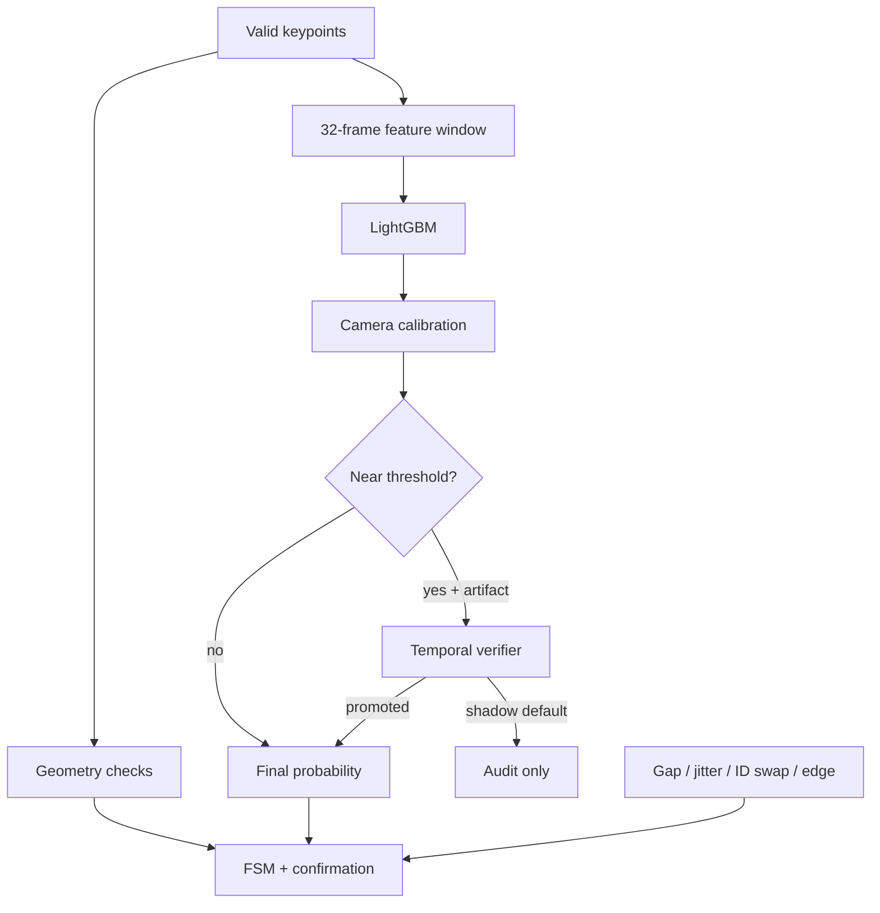
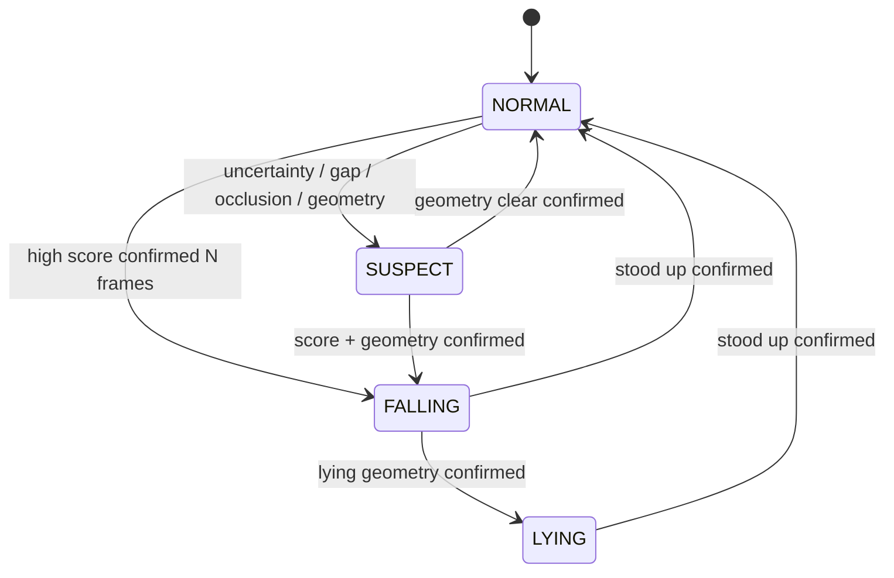

# SilentGuard — Production Architecture, Safety Pipeline & Roadmap

> Tài liệu kiến trúc đầy đủ cho trạng thái mục tiêu sau khi hợp nhất `feature/AI` và `feature/backend`.
> Cập nhật: 2026-08-20. Entry point AI production: `src/edge/AI-Core/ver9.py`.

## 1. Executive summary

SilentGuard là hệ thống giám sát té ngã theo kiến trúc edge-first. Video được xử lý tại edge; backend nhận sự kiện, heartbeat và metadata thay vì phụ thuộc vào video thô. Quyết định an toàn không đến từ một model duy nhất mà từ nhiều lớp độc lập:

1. kiểm tra chất lượng camera/frame;
2. YOLOv8n-Pose và ByteTrack;
3. đặc trưng động học có chuẩn hóa;
4. LightGBM theo contract cố định;
5. FSM thời gian thực và các guardrail hình học;
6. lifecycle backend có compare-and-set, silent recheck và escalation;
7. durable outbox, audit trace và cơ chế fallback.

Mục tiêu thiết kế là **fail safe, không fail silent**: mất frame, mất track, lỗi mạng, ID swap hoặc backend chậm đều phải tạo trạng thái chất lượng dữ liệu rõ ràng, không được âm thầm xem là “không ngã”.

## 2. Toàn cảnh hệ thống

```mermaid
flowchart LR
    CAM[Camera / Imou / RTSP / HLS / MP4] --> CAP[Threaded latest-frame capture]
    CAP --> HEALTH[Frame & camera health gates]
    HEALTH --> POSE[OpenVINO YOLO Pose 640/800]
    POSE --> TRACK[Ordered ByteTrack]
    TRACK --> FEATURES[Pose geometry + motion features]
    FEATURES --> LGB[LightGBM fall probability]
    FEATURES --> TEMP[Temporal verifier - shadow/optional]
    LGB --> FSM[Per-person safety FSM]
    TEMP --> FSM
    FSM --> OUTBOX[SQLite durable outbox]
    OUTBOX --> API[FastAPI event API]
    FSM --> TRACE[Anonymous feature incidents]
    API --> DB[(Supabase/PostgreSQL)]
    API --> ALERT[Alert engine]
    DB --> SCHED[Heartbeat + silent recheck + escalation scheduler]
    ALERT --> PUSH[FCM / household notification]
    SCHED --> PUSH
    SCHED --> CALL[Emergency call / backup contacts]
    CAP --> WS[FramePublisher]
    WS --> STREAM[Backend WebSocket relay]
    STREAM --> APP[Mobile / Flutter Web]
```



### Trust boundaries

| Boundary | Dữ liệu đi qua | Cơ chế bảo vệ |
|---|---|---|
| Camera → Edge | frame/video stream | timeout, reconnect, corruption/freeze checks |
| Edge → Backend | event, heartbeat, health metadata | device key/upload token, retry, durable outbox |
| Backend → Database | lifecycle event | validation, ownership checks, compare-and-set |
| Backend → Client | alerts/history/live JPEG | authentication, household scoping, WebSocket separation |
| Edge → Dataset | normalized skeleton/features | no raw frames by default, retention, schema validation |

## 3. AI edge runtime

### 3.1 Input and capture

Nguồn hỗ trợ gồm local video, upload URL, RTSP, RTMP, HLS và Imou dynamic stream. Live input dùng `ThreadedCamera` với hai tầng:

- downloader lấy frame mới nhất và tự reconnect;
- pacer đẩy frame vào output queue giới hạn;
- queue nhỏ áp dụng latest-frame policy, tránh backlog biến thành latency tích lũy;
- timer FSM dùng `time.monotonic()`, không dùng số frame để tính thời gian nằm.

Luồng upload được tải về file tạm để tránh `VideoCapture` treo trên HTTP. File tạm được dọn khi kết thúc.

### 3.2 Camera and frame health plane

`SystemHealthMonitor` tách khỏi `PersonFSM`. Đây là hai plane độc lập: lỗi camera không được giả làm quyết định “người bình thường”. Các tín hiệu gồm:

- `CAMERA_OFFLINE`: không có frame trong watchdog window;
- `STREAM_FROZEN`: frame lặp lại vượt ngưỡng;
- `FRAME_CORRUPTED`: frame rỗng, đơn sắc hoặc bất thường;
- `FRAME_JITTER`: độ lệch thời gian đến frame quá lớn;
- `CAMERA_SHIFTED`: optical-flow/baseline cho thấy camera đổi góc;
- `LENS_DEGRADED`: độ nét/contrast suy giảm;
- `CAMERA_OCCLUDED`: vật thể chiếm gần toàn frame hoặc mất người sau khi áp sát camera.

Health được gửi qua `POST /api/events/system-health`. Safe zone bị vô hiệu khi camera shifted vì polygon cũ không còn đáng tin.

### 3.3 OpenVINO pose inference

Hai artifact đã được kiểm chứng:

| Profile | Input | Mục tiêu | Native async p95 CPU tham chiếu |
|---|---:|---|---:|
| latency | 640×640 | mặc định một camera | 68.22 ms |
| accuracy | 800×800 | người xa/góc khó | 128.64 ms |

Chọn lúc khởi động bằng `--openvino-imgsz 640|800`. Artifact tĩnh được chọn thay vì đổi shape trong lúc tracking để không reset backend/tracker. `OpenVINOAsyncPoseTracker` dùng:

- `ov.AsyncInferQueue`;
- `PERFORMANCE_HINT=LATENCY`;
- sequence number cho từng request;
- callback có reorder gate;
- NMS và keypoint scaling tương thích Ultralytics 8.4.70;
- ByteTrack chỉ cập nhật tuần tự.

Nếu native backend không khởi tạo được, runtime fallback về Ultralytics/PyTorch theo giao dịch nguyên tử: không bao giờ để model bị gán nửa chừng.

### 3.4 Tracking and identity continuity

ByteTrack là tracker chính. Lớp bảo vệ bổ sung gồm:

- spatial Re-ID theo IoU và khoảng cách tâm;
- cache track mất dấu;
- TTL dài hơn cho `FALLING/LYING` và khi camera offline;
- vận tốc chuẩn hóa theo chiều dài thân người;
- ID-swap quarantine khi dịch chuyển phi vật lý;
- Kalman predict-only trong khoảng mất dấu;
- `TRANSITION_GAP` được bật khi global freeze hoặc track tái xuất hiện sau gap;
- predicted measurements luôn mang `low_confidence` và không được tự ý escalate.

Kalman không tạo bằng chứng ngã. Nó chỉ duy trì continuity để hệ thống không biến mất tín hiệu thành vận tốc 0 giả.

### 3.5 Pose and feature engineering

Pose COCO gồm 17 keypoint. Runtime dùng:

- torso angle từ shoulder midpoint đến hip midpoint;
- hip vertical velocity;
- EMA velocity;
- jerk theo delta-time thực;
- width/height aspect ratio;
- standing history;
- median standing-height baseline;
- height-drop ratio;
- lying ratio và floor ratio theo sliding window;
- normalized body-speed cho physical plausibility;
- safe/danger polygon theo tọa độ normalized.

LightGBM hiện dùng schema version `fall-features-v2`, đúng 12 feature có thứ tự cố định. Runtime từ chối model có số feature không khớp thay vì dự đoán sai âm thầm.

### 3.6 Hybrid decision stack



Temperature/bias calibration mặc định là identity. Temporal verifier nhận tensor `[1,32,5]`, mặc định `shadow`: ghi dự đoán nhưng không thay đổi alert. Chỉ sau khi registry và replay guardrail đạt yêu cầu mới dùng `--no-temporal-shadow`.

### 3.7 Per-person FSM



Các nguyên tắc quan trọng:

- timer nằm là wall-clock monotonic và chỉ chạy khi state thật sự `LYING`;
- đứng dậy chuyển về `NORMAL`, đóng incident và reset escalation flags;
- measurement quarantine không được consume `TRANSITION_GAP` trước frame thật đáng tin;
- slow slide có geometry override độc lập với score ML;
- safe zone có thể suppress fast flop nhưng fail-safe về danger khi config lỗi;
- chất lượng dữ liệu kém tăng confirmation multiplier thay vì tạo quyết định chắc chắn giả;
- disappearance giữa frame đủ lâu trở thành `OCCLUSION_SUSPECT` và có alert fail-safe.

### 3.8 Adaptive performance

Khi mọi người `NORMAL`, runtime có thể skip inference thích ứng hoặc vào motion hibernation sau cooldown. Khi có `SUSPECT/FALLING/LYING`, skip về 0. Profiler bounded ghi:

- `pose_track` p50/p95;
- `lightgbm` p50/p95;
- end-to-end `frame_age`;
- sample count.

`benchmark_openvino.py` so native async với wrapper đồng bộ và trả exit code khác 0 khi regression vượt budget.

## 4. Delivery and resilience

### 4.1 Durable outbox

Event detect và heartbeat thất bại được ghi SQLite WAL trong `.edge-state/outbox.sqlite3`:

- dedupe key duy nhất;
- at-least-once delivery;
- exponential backoff có giới hạn;
- record sent được dọn sau retention;
- network thread không block inference.

Backend phải xử lý idempotency vì at-least-once có thể gửi lại.

### 4.2 Recovery handshake

```mermaid
sequenceDiagram
    participant E as Edge FSM
    participant O as Durable Outbox
    participant B as Backend API
    participant D as Database
    E->>B: POST /detect
    B->>D: create active event
    B-->>E: event_id
    loop while lying
        E->>B: PUT /heartbeat/{event_id} duration/status
        B->>D: update duration + heartbeat
    end
    E->>E: standing confirmed
    E->>B: PUT heartbeat status=recovered
    B->>D: CAS active → resolved; clear escalate_after
    alt request fails
        E->>O: enqueue recovery
        O->>B: retry until acknowledged
    end
```

Edge chỉ xóa `event_id` sau backend acknowledgment. Backend chuẩn hóa legacy `recovered` thành `resolved`.

## 5. Backend safety lifecycle

### 5.1 API surface liên quan AI

| Endpoint | Vai trò |
|---|---|
| `GET /api/events/edge-config` | safe zones, patient profile, fail-safe configuration |
| `POST /api/events/system-health` | camera/frame infrastructure health |
| `POST /api/events/detect` | tạo incident từ Edge AI |
| `PUT /api/events/heartbeat/{event_id}` | duration và trạng thái pose mới nhất |
| `POST /api/events/upload_clip` | clip sự kiện có event ID |
| `POST /api/events/upload-video` | upload flow |
| `GET /api/events/upload-status/{token}` | theo dõi job upload |
| `PUT /api/cameras/{id}/safety-config` | cấu hình vùng an toàn/profile |
| `WS /api/streams/{camera_id}/publish` | edge publish JPEG |
| `WS /api/streams/{camera_id}/view` | client xem stream relay |

### 5.2 Event lifecycle

Các trạng thái đóng gồm `resolved`, `recovered` legacy, `acknowledged`, `escalated`, `logged_only`. Scheduler và alert engine phải bỏ qua event đã đóng.

Severity không được suy diễn từ thời gian máy chủ nếu heartbeat biến mất. Chỉ `duration_sec` do Edge — nơi có bằng chứng pose — mới được dùng để tăng severity. Điều này trực tiếp ngăn bệnh “người đã đứng dậy nhưng backend vẫn đếm”.

### 5.3 Alert engine

Alert engine thực hiện:

1. deduplicate chỉ trên event active;
2. áp suppression/user thresholds;
3. phân loại severity;
4. gửi primary notification;
5. đặt `escalate_after` cho HIGH/CRITICAL;
6. ghi escalation trace;
7. không ghi đè event đã recovery bằng update đến muộn.

### 5.4 Scheduler and silent recheck

Scheduler gồm bốn nhóm trách nhiệm:

- camera heartbeat watchdog;
- severity escalation theo `duration_sec` đã heartbeat;
- silent recheck sau khoảng theo dõi;
- backup-contact escalation khi `escalate_after` đến hạn.

Silent recheck chỉ coi “still lying” khi có heartbeat mới và duration tăng hơn baseline. Không có heartbeat mới không phải bằng chứng người vẫn nằm. Database update dùng compare-and-set để recovery đồng thời thắng escalation cũ.

### 5.5 Persistence contract

Migration safety lifecycle bổ sung các trường cần thiết như heartbeat edge, baseline/recheck và thời điểm escalation. Production schema là migration PostgreSQL/Supabase trong `backend/migrations`; Prisma legacy không phải nguồn schema chuẩn.

## 6. Live streaming plane

Video xem trực tiếp tách khỏi decision plane:

```text
Edge annotated JPEG → publisher WebSocket → backend relay → mobile/web viewer
```

Viewer chậm hoặc mất kết nối không được block AI. Face được blur trong RAM trước khi publish/ghi clip. Luồng quyết định dùng frame gốc trong memory trước render; nội dung render không được quay lại làm input AI.

## 7. Privacy-first data pipeline

Runtime chỉ ghi `feature-incidents.jsonl` khi có trigger:

- uncertainty zone;
- FSM SUSPECT/FALL;
- ID swap;
- transition gap;
- safe-zone override.

Mỗi incident chứa context bounded, skeleton normalized, bbox normalized, feature, state, quality flags và version. Không chứa raw frame. Schema `fall-sequence-v1` chặn:

- thiếu 17 keypoint;
- timestamp đảo;
- NaN/Infinity;
- sequence rỗng;
- schema không tương thích.

Dataset builder ghép review, loại duplicate, loại reviewer disagreement và split deterministic theo anonymous subject, fallback camera. Không split từng frame vì sẽ gây temporal leakage.

Nhãn chuẩn: `fall`, `not_fall`, `uncertain`, `intentional_lie`, `assisted_fall`, `sit_or_bend`, `tracking_failure`, `camera_failure`.

Retention mặc định 30 ngày và chỉ xóa file đúng pattern `feature-incidents*.jsonl`.

## 8. Security and operational controls

- Không commit live secret; CI quét key phổ biến.
- Edge dùng device key hoặc upload token.
- CORS production phải là allowlist, không wildcard với credentials.
- Camera/device access được scope theo household.
- Device key rotation có endpoint riêng.
- Audit trace chỉ lưu metadata.
- Outbox database và feature trace cần volume bền vững trên edge.
- Health endpoint của Edge phục vụ orchestration/liveness.
- Network calls có timeout; retry không chạy trên inference thread.

## 9. Failure-mode matrix

| Failure | Detection | Runtime reaction | Backend reaction |
|---|---|---|---|
| Frame corrupted | variance/content gate | drop inference | health metadata |
| Stream frozen | duplicate-frame window | mark quality, preserve LYING timer | system health event |
| Camera moved | optical flow baseline | disable zones | notify camera issue |
| Person occluded | lost mid-frame/cache | SUSPECT + Kalman quarantine | fail-safe incident if unresolved |
| ID swap | body-speed/pixel jump | reset EMA, quarantine | no false timer jump |
| Backend offline | HTTP failure | durable outbox retry | idempotent receive later |
| Recovery races escalation | status heartbeat | retry until ACK | CAS closes event, clears escalation |
| Model artifact mismatch | schema/shape validation | refuse/fallback | no malformed event |
| Temporal model uncertain | uncertainty gate | shadow by default | audit only |
| Viewer slow | publisher queue | drop display frame | AI unaffected |

## 10. Testing and evidence

AI suite hiện bao phủ FSM recovery, fixed timestep, slow slide, safe zones, transition gap, Kalman, camera health, outbox, feature contract, dataset pipeline và OpenVINO IR thật 640/800. Backend suite bao phủ event heartbeat, lifecycle, scheduler, alert engine, camera config, auth/CORS và API routes.

Các lệnh chuẩn:

```powershell
$env:YOLO_CONFIG_DIR='.ultralytics'
C:\Users\vinhv\anaconda3\envs\ai_env\python.exe -m pytest src/edge/AI-Core -q -p no:cacheprovider
python -m pytest backend/tests -q -p no:cacheprovider
```

Benchmark:

```powershell
python src/edge/AI-Core/benchmark_openvino.py `
  src/edge/AI-Core/yolov8n-pose_openvino_model --runs 20 --device CPU
```

## 11. Deployment profiles

### Single camera / latency priority

```text
--openvino-device CPU
--openvino-imgsz 640
--openvino-requests 1 hoặc 2 sau benchmark
--temporal-shadow
```

### Accuracy priority / subject far from camera

```text
--openvino-imgsz 800
--profile-interval 30
```

### Dataset collection

```text
--record-features
--feature-context-frames 64
--feature-record-cooldown 5
--feature-retention-days 30
--temporal-shadow
```

## 12. Những giới hạn hiện tại — không được che giấu

1. `AsyncInferQueue` đã là native nhưng một camera vẫn serialize trước ByteTrack để giữ đúng ID; chưa có shared multi-camera scheduler.
2. Artifact 640 và 800 là static. Chọn profile lúc startup, chưa hot-switch trong cùng tracker.
3. Spatial Re-ID chưa có appearance embedding.
4. Temporal verifier đã có contract nhưng chưa có model được train từ dataset thật.
5. Calibration parameters cần incident đã review; mặc định vẫn identity.
6. Danger polygon phụ thuộc cấu hình camera chính xác; camera shift buộc fail-safe.
7. Benchmark hiện là CPU tham chiếu trên máy phát triển, không thay cho benchmark thiết bị edge production.
8. At-least-once delivery yêu cầu backend tiếp tục duy trì idempotency.
9. Feature JSONL cần chiến lược encryption-at-rest/secure volume ở production.
10. Chưa có UI review nhãn; hiện dùng JSONL/CLI.

## 13. Roadmap ưu tiên

### P0 — trước pilot production

- chạy replay trên video thật cho fall/recovery/occlusion/crossing;
- migration safety lifecycle trên staging rồi production;
- kiểm tra idempotency detect/heartbeat dưới retry;
- dashboard p50/p95/frame-age/outbox depth;
- alert khi durable outbox backlog vượt budget;
- xác nhận retention và consent policy;
- canary một camera, rollback tự động về synchronous 640;
- load/soak test WebSocket và scheduler race.

### P1 — sau khi có dữ liệu review

- calibration temperature/bias và threshold riêng từng camera;
- temporal TCN/GRU train trên group split;
- shadow evaluation, sau đó gated promotion qua model registry;
- hard-negative mining cho ngồi nhanh, nằm giường, cúi người, assisted fall;
- evaluation theo recall, precision, false alarms/hour, detection delay;
- label-review UI và reviewer agreement workflow.

### P2 — scale và accuracy nâng cao

- shared OpenVINO request pool cho nhiều camera;
- conditional appearance Re-ID khi crossing;
- homography/ground-plane calibration wizard;
- dynamic batching chỉ cho multi-camera throughput;
- 3D pose lifting chỉ ở uncertainty zone/góc top-down;
- drift detection theo camera, pose confidence và feature distribution;
- signed model registry, staged rollout và automated rollback.

### P3 — hardening dài hạn

- encryption-at-rest cho edge state;
- SBOM, vulnerability scanning và artifact signing;
- chaos test mất mạng/mất điện/restart giữa recovery;
- formal SLO cho detection latency, delivery latency và false alerts;
- disaster-recovery drill cho database, notification và device-key rotation.

## 14. Definition of done cho model tương lai

Một model mới chỉ được promote khỏi `shadow` khi:

1. checksum và feature schema đã đăng ký;
2. train/validation/test split theo group, không leakage;
3. test set chứa camera/người chưa thấy;
4. recall fall không thấp hơn baseline;
5. false alarms/hour nằm trong budget;
6. recovery latency và stood-up behavior không regression;
7. OpenVINO p95 đạt device budget;
8. replay regression pass;
9. canary pass và rollback đã thử;
10. model card ghi rõ dữ liệu, giới hạn, threshold và calibration.

## 15. Source of truth

| Phạm vi | Nguồn chuẩn |
|---|---|
| AI runtime | `src/edge/AI-Core/ver9.py` |
| Native async pose | `src/edge/AI-Core/openvino_async_pose.py` |
| Runtime safety/outbox | `src/edge/AI-Core/runtime_safety.py` |
| Dataset pipeline | `src/edge/AI-Core/dataset_pipeline.py` |
| Temporal contract | `src/edge/AI-Core/temporal_verifier.py` |
| AI operations | `src/edge/AI-Core/DATA_PIPELINE.md` |
| Backend event lifecycle | `backend/app/api/events.py` |
| Alert policy | `backend/app/services/alert_engine.py` |
| Scheduler/escalation | `backend/app/services/scheduler.py` |
| Database changes | `backend/migrations/` |
| End-to-end architecture | tài liệu này |

---

Kiến trúc hiện tại cố ý kết hợp ML, geometry, state machine và backend lifecycle. Không lớp nào một mình đủ để bảo đảm an toàn; độ tin cậy đến từ việc mọi lớp có contract, telemetry, fallback và bằng chứng replay riêng.
