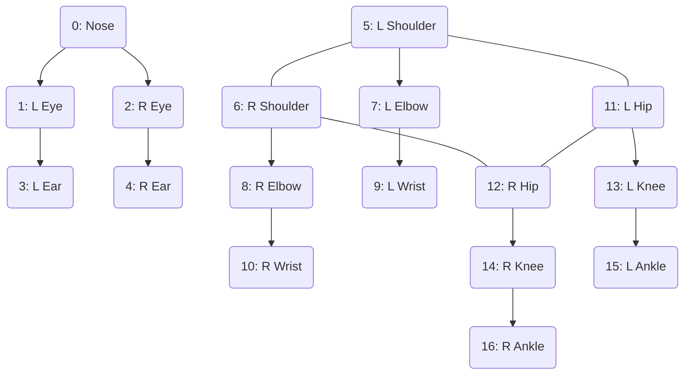
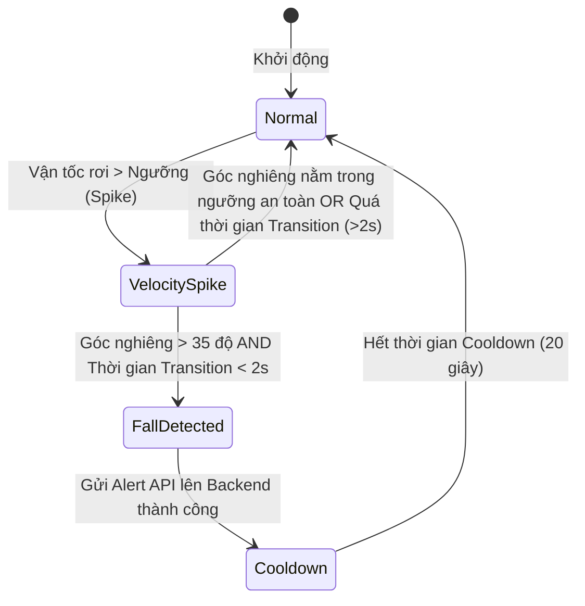

# Tài liệu Kiến trúc & Giải pháp AI: SilentGuard Passive Fall Detection

Tài liệu này mô tả chi tiết giải pháp trí tuệ nhân tạo (AI) được triển khai trên Edge Server của SilentGuard để phát hiện hành vi ngã (fall detection) từ camera an ninh (Imou/HLS Stream) sử dụng mô hình YOLOv8-Pose.

---

## 1. Tổng Quan Giải Pháp

SilentGuard sử dụng mô hình ước lượng tư thế người (**Pose Estimation**) kết hợp với thuật toán phân tích chuỗi chuyển động theo thời gian thực (**Real-time Temporal Analysis**). Giải pháp này mang lại nhiều ưu điểm so với phân tích hình ảnh tĩnh thông thường:
* **Bảo vệ quyền riêng tư**: Chỉ sử dụng cấu trúc xương (keypoints) để phân tích hành vi. Gương mặt được tự động làm mờ cục bộ (Gaussian Blur) ngay trong RAM trước khi xuất luồng video.
* **Độ chính xác cao**: Phân biệt được cú ngã thật sự (tốc độ cao, góc nghiêng lớn, mất thăng bằng) với các hành vi sinh hoạt bình thường như cúi người, chủ động nằm xuống giường/sofa.
* **Tối ưu tài nguyên**: Sử dụng mô hình YOLOv8-pose phiên bản nano (`yolov8n-pose.pt`) siêu nhẹ giúp chạy mượt mà trên môi trường CPU/Cloud giá rẻ (như Railway) với tốc độ xử lý ổn định (~3-5 FPS trên CPU đơn nhân).

---

## 2. Mô Hình YOLOv8-Pose & Cấu Trúc Keypoints

Mô hình YOLOv8-Pose được huấn luyện để phát hiện người và trích xuất đồng thời 17 điểm mốc xương (keypoints) theo chuẩn COCO dataset.

### Các keypoints trọng tâm trong thuật toán phát hiện ngã:
* **Shoulders (Điểm 5, 6)**: Điểm vai trái và vai phải. Trọng tâm vai được tính bằng trung bình cộng tọa độ của hai vai.
* **Hips (Điểm 11, 12)**: Điểm hông trái và hông phải. Trọng tâm hông được tính bằng trung bình cộng tọa độ của hai hông.
* **Face Keypoints (Điểm 0 -> 4)**: Dùng để xác định vùng đầu và áp dụng hiệu ứng làm mờ bảo vệ quyền riêng tư.

---

## 3. Thuật Toán Phát Hiện Ngã (Fall Detection Logic)

Thuật toán kết hợp ba đặc trưng hình học và động học thông qua một cửa sổ trượt dữ liệu dạng hàng đợi (`Sliding Window Queue` kích thước $N = 32$ frames):

### Bước 1: Tính góc nghiêng thân người (Torso Lean Angle)
Góc thân người ($\theta$) được tính giữa đường nối trung điểm vai (Shoulders) - trung điểm hông (Hips) với phương thẳng đứng (trục Y).
$$\theta = \arctan2(|X_{hip} - X_{shoulder}|, Y_{hip} - Y_{shoulder}) \times \frac{180}{\pi}$$
* Khi đứng thẳng: $\theta \approx 0^\circ$
* Khi nằm song song với sàn: $\theta \approx 90^\circ$
* **Điều kiện ngã**: $\theta > 35^\circ$ (Cấu hình qua `ANGLE_THRESHOLD`).

### Bước 2: Tính vận tốc rơi thẳng đứng (Vertical Velocity)
Đo tốc độ di chuyển đi xuống của trọng tâm hông (Hips Y) giữa hai khung hình liên tiếp.
$$v_y = (Y_{hip\_current} - Y_{hip\_prev}) \times FPS$$
* Đơn vị: `pixels/second`.
* **Điều kiện ngã**: Xuất hiện đột ngột một xung vận tốc vượt quá ngưỡng `180 pixels/sec` (Cấu hình qua `VELOCITY_THRESHOLD`).

### Bước 3: Ràng buộc thời gian biến thiên (Transition Time Limit)
Ngăn chặn các cảnh báo giả do người dùng nằm xuống giường một cách chủ động và từ từ:
$$\Delta t = \frac{Frame_{fall\_detected} - Frame_{velocity\_spike\_started}}{FPS}$$
* **Điều kiện ngã**: Thời gian hoàn tất cú ngã phải ngắn hơn giới hạn `2.0 giây` (Cấu hình qua `TRANSITION_LIMIT`).

### Sơ đồ trạng thái máy (State Machine):

---

## 4. Tham Số Cấu Hình AI (Hyperparameters)

Các tham số này được tối ưu hóa thông qua thực nghiệm để đạt tỉ lệ Recall cao nhất trong môi trường hộ gia đình:

| Tham số | Giá trị | Ý nghĩa |
| :--- | :---: | :--- |
| `CONFIDENCE_THRESHOLD` | `0.65` | Ngưỡng tin cậy tối thiểu để chấp nhận tọa độ các điểm mốc xương khớp (tránh nhiễu vật cản). |
| `WINDOW_SIZE` | `32` | Số lượng khung hình lưu trong hàng đợi cửa sổ trượt (sliding window) để phân tích động học. |
| `VELOCITY_THRESHOLD` | `180` | Tốc độ rơi thẳng đứng tối thiểu của hông (pixels/giây) để kích hoạt tín hiệu bắt đầu ngã. |
| `ANGLE_THRESHOLD` | `35` | Góc nghiêng tối thiểu của phần thân so với trục thẳng đứng để xác định là trạng thái ngã/nằm. |
| `TRANSITION_LIMIT` | `2.0` | Khoảng thời gian tối đa (giây) cho phép chuyển từ trạng thái đứng sang ngã nhằm loại bỏ hành vi nằm ngủ bình thường. |
| `COOLDOWN_TIME` | `20.0` | Thời gian đóng băng cảnh báo (giây) sau khi gửi một sự kiện ngã nhằm tránh spam API liên tục lên Backend. |

---

## 5. Cơ Chế Làm Mờ Bảo Vệ Quyền Riêng Tư (Privacy Protection)

Trước khi ghi khung hình video ra file đầu ra, hệ thống tự động:
1. Phát hiện tọa độ của 5 điểm mốc trên mặt (Mũi, 2 Mắt, 2 Tai).
2. Tạo một hình hộp bao quanh vùng mặt kèm theo khoảng đệm (`padding = 25` pixels).
3. Áp dụng thuật toán **Gaussian Blur** với kích thước nhân (kernel) được tính động theo độ phân giải vùng mặt trực tiếp trên bộ nhớ RAM. 
4. Ghi đè hình ảnh đã mờ hóa lên luồng stream đầu ra, đảm bảo hình ảnh mặt của người dùng không bao giờ lưu trữ ở dạng rõ nét trên đĩa cứng hoặc truyền đi ngoài thiết bị.
